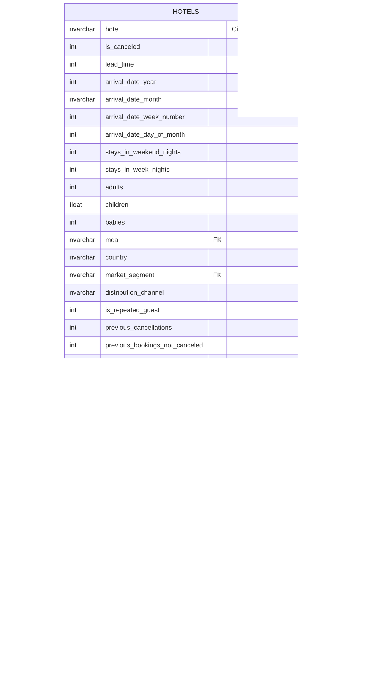

# Hotel Revenue Analysis (SQL Server + Power BI)

An end-to-end BI project analysing three years (2018–2020) of booking data for two hotels — a **City Hotel** and a **Resort Hotel**. Raw Excel sheets are loaded into SQL Server, unioned and enriched with lookup tables in SQL, and visualised in a Power BI dashboard.

```
Excel workbook ──► SQL Server (dbo) ──► SQL query (CTE + joins) ──► Power BI (Query1) ──► Dashboard
```

## Repository structure

| Path | Contents |
|---|---|
| `data/hotel_revenue_historical_full.xlsx` | Source workbook: sheets `2018`, `2019`, `2020`, `meal_cost`, `market_segment` |
| `sql/hotel_revenue_query.sql` | Original T-SQL: unions yearly tables, computes revenue, joins lookups |
| `powerbi/Hotel_Revenue_Dashboard.pbix` | Power BI report built on the joined query |
| `docs/schema.md` | Full column-level data dictionary |

## Data model (schema)

The model is a simple **star schema**: one booking fact table (the three yearly sheets stacked into a `hotels` CTE) and two lookup dimensions.



### Source tables

| SQL Server table | Excel sheet | Rows | Role |
|---|---|---:|---|
| `dbo.['2018$']` | 2018 | 21,996 | Fact (bookings) |
| `dbo.['2019$']` | 2019 | 79,264 | Fact (bookings) |
| `dbo.['2020$']` | 2020 | 40,687 | Fact (bookings) |
| `dbo.market_segment$` | market_segment | 8 | Dimension – discount by segment |
| `dbo.meal_cost$` | meal_cost | 5 | Dimension – cost by meal plan |

### Lookup values

| market_segment | Discount |  | meal | Cost |
|---|---:|---|---|---:|
| Undefined | 0.00 | | Undefined | 0.00 |
| Direct | 0.10 | | BB (Bed & Breakfast) | 12.99 |
| Groups | 0.10 | | HB (Half Board) | 17.99 |
| Corporate | 0.15 | | FB (Full Board) | 21.99 |
| Aviation | 0.20 | | SC (Self Catering) | 35.00 |
| Offline TA/TO | 0.30 | | | |
| Online TA | 0.30 | | | |
| Complementary | 1.00 | | | |

## SQL logic

```sql
WITH hotels AS (
    SELECT * FROM dbo.['2018$']
    UNION
    SELECT * FROM dbo.['2019$']
    UNION
    SELECT * FROM dbo.['2020$']
)
SELECT *
FROM hotels
LEFT JOIN dbo.market_segment$ ON hotels.market_segment = market_segment$.market_segment
LEFT JOIN dbo.meal_cost$      ON meal_cost$.meal       = hotels.meal;
```

**Revenue** = `(stays_in_week_nights + stays_in_weekend_nights) × adr`

| Year | City Hotel | Resort Hotel |
|---|---:|---:|
| 2018 | 1,764,667.57 | 3,120,849.49 |
| 2019 | 10,755,979.11 | 9,432,430.29 |
| 2020 | 8,018,122.43 | 6,266,123.81 |

*(Gross revenue before discount, computed from the deduplicated data the query returns.)*

## Power BI dashboard

The joined query is imported into Power BI as a single flattened table, **`Query1`**. The report page contains:

- **KPI cards** – Revenue, Average ADR, Total Nights, Discount, Required Car Parking Spaces
- **Line charts** (by `reservation_status_date`, split by hotel) – Revenue, ADR, Total Nights, Discount, Parking spaces
- **Donut chart** – Revenue share by hotel
- **Matrix** – Revenue, parking spaces and **Parking Percentage** by hotel and year
- **Slicers** – Hotel, Country, Date hierarchy (Year / Quarter / Month / Day)

Fields created in Power BI: `Revenue`, `Total Nights`, `Parking Percentage`.

## Notes and caveats

- **`UNION` removes duplicate rows.** The three yearly sheets hold 141,947 rows, but 41,191 of them are exact duplicates, so the CTE returns **100,756** bookings. Use `UNION ALL` if every row should count as a separate booking.
- Revenue includes **cancelled bookings** (`is_canceled = 1`); filter on `is_canceled = 0` for realised revenue.
- `Discount` and meal `Cost` are joined in but are not applied in the SQL revenue figure. A net figure would be `nights × adr × (1 − Discount)`.

## Tools

SQL Server (SSMS) · Microsoft Excel · Power BI Desktop
